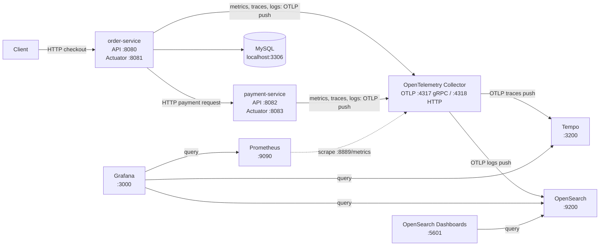
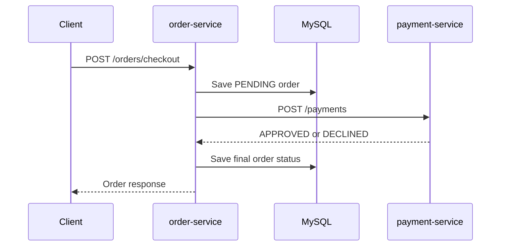

# Spring Boot Observability Lab

Learn metrics, distributed traces, and logs by running two Spring Boot services
and five progressively richer observability stacks on your own machine.

[](https://www.java.com/)
[](https://spring.io/projects/spring-boot)
[](https://opentelemetry.io/)
[](https://docs.docker.com/compose/)
[](LICENSE)

## What you will learn

- How Prometheus pulls metrics from an application or OpenTelemetry Collector.
- How an application pushes telemetry with OTLP.
- How a trace follows an HTTP request across two Spring services.
- How to inspect traces in Tempo and logs in Loki or OpenSearch.
- How metric names and attributes change between application code and a backend.
- How Grafana data sources connect the signals.
- How Docker Compose volumes and ports affect local stack switching.

This project is for developers who want to learn observability by running
examples locally. You do not need previous experience with Prometheus, tracing,
or log backends.

## Architecture

The architecture image is not in this checkout yet. Add
[`docs/images/Spring_Boot_OpenTelemetry_Observability_Architecture.png`](docs/images/Spring_Boot_OpenTelemetry_Observability_Architecture.png)
to show the supplied diagram. The Mermaid diagram below follows the current
application configuration and the v5 stack. Solid telemetry arrows are pushes;
the dashed Prometheus arrow is a pull scrape.



In the current working tree, both services send telemetry to the Collector on
`localhost:4318`. Prometheus scrapes the Collector's exporter on port 8889;
the Collector exports traces to Tempo and logs to OpenSearch in v5. Earlier
versions change this pipeline. See [the version guides](#the-five-versions).

### The two services

`order-service` stores orders in MySQL and calls `payment-service` during
checkout. `payment-service` simulates a payment gateway with a configurable
delay, technical failure rate, and business-decline threshold. Its payment
decline is a normal payment result; a simulated technical failure is HTTP 503.

The `POST /orders/checkout` flow is:



If the simulated gateway has a technical failure, checkout returns HTTP 503
after marking the order failed. A business decline is returned as a payment
response, not a payment HTTP error. More details are in the
[HTTP API reference](docs/REFERENCE.md#3-http-api).

## The five versions

Run one stack version at a time. Versions reuse host ports, and v4/v5 also
share the v3 Compose project name and its Prometheus/Grafana volumes.

| Version | What is new | Metrics | Traces | Logs | Main UI URLs | Extra RAM | Difficulty |
|---|---|---|---|---|---|---|---|
| [v1-metrics](v1-metrics/README.md) | Prometheus scrapes the order service directly | Prometheus | None | None | [Grafana](http://localhost:3000), [Prometheus](http://localhost:9090) | Not specified; ⚠️ estimate not verified | Beginner |
| [v2-opentelemetry](v2-opentelemetry/README.md) | OTLP receiver and Collector metrics exporter | Prometheus | Collector debug output; no trace UI | None | [Grafana](http://localhost:3000), [Prometheus](http://localhost:9090) | Not specified; ⚠️ estimate not verified | Beginner |
| [v3-tempo](v3-tempo/README.md) | Tempo trace storage and Grafana data source | Prometheus | Tempo | None | [Grafana](http://localhost:3000), [Tempo readiness](http://localhost:3200/ready) | Not specified; ⚠️ estimate not verified | Intermediate |
| [v4-loki](v4-loki/README.md) | Loki log storage and Grafana data source | Prometheus | Tempo | Loki | [Grafana](http://localhost:3000), [Loki readiness](http://localhost:3100/ready) | Not specified; ⚠️ estimate not verified | Intermediate |
| [v5-opensearch](v5-opensearch/README.md) | OpenSearch log storage and OpenSearch Dashboards | Prometheus | Tempo | OpenSearch | [Grafana](http://localhost:3000), [OpenSearch](http://localhost:9200), [Dashboards](http://localhost:5601) | About 2 GB free RAM per the Compose comment; ⚠️ actual use not verified | Advanced |

The v2 Collector exports traces to its debug exporter, not to a trace database.
The exact app settings needed for each version are documented in each guide;
the current checked-out application state is not compatible with v1's direct
Prometheus scrape without the earlier Micrometer Prometheus configuration.

## Repository structure

```text
.
|-- API Documentation & Dashboards/   Postman collections and Grafana dashboards
|-- docs/
|   `-- REFERENCE.md                  source-linked configuration and API facts
|-- order-service/                    order API and MySQL persistence
|-- payment-service/                  simulated payment API
|-- v1-metrics/                       direct Prometheus scrape
|-- v2-opentelemetry/                 OTLP Collector and Prometheus
|-- v3-tempo/                         adds Tempo
|-- v4-loki/                          adds Loki
|-- v5-opensearch/                    uses OpenSearch for logs
|-- .github/                          issue and pull request templates
|-- CONTRIBUTING.md
|-- CODE_OF_CONDUCT.md
|-- LICENSE
`-- SECURITY.md
```

The Postman collections and dashboard JSON files are in
[`API Documentation & Dashboards/`](API%20Documentation%20%26%20Dashboards/).
Compose does not automatically provision those dashboard JSON files; import a
dashboard manually if you want to use it.

## Prerequisites

- Java 21. Each service includes a Maven wrapper; a separate Maven install is
  not required.
- Docker Desktop or Docker Engine with Docker Compose.
- MySQL 8 for `order-service`. None of the observability Compose files starts
  MySQL.
- Postman is optional; the API can also be called with `curl.exe` or `curl`.
- Free ports: 3306 (MySQL), 8080/8081 (order API/Actuator),
  8082/8083 (payment API/Actuator), 3000 (Grafana), 9090 (Prometheus),
  4317/4318 (OTLP), 8889 (Collector metrics), 3200 (Tempo), 3100 (Loki),
  9200 (OpenSearch), and 5601 (OpenSearch Dashboards). A version does not
  necessarily use every listed port.
- Free RAM: the v5 Compose file comments recommend about 2 GB free. Other
  Compose files declare no complete stack memory estimate or container memory
  limits; their requirements are ⚠️ not verified.

## Quick start: find a distributed trace

This walkthrough uses v3, which includes Tempo. Keep MySQL and the two apps
running on the host. Open separate terminals for the stack and each service.

### PowerShell

```powershell
docker run --name observability-mysql -e MYSQL_ROOT_PASSWORD=rootPassword -e MYSQL_DATABASE=orders_db -p 3306:3306 -d mysql:8
Set-Location .\v3-tempo
docker compose up -d
Set-Location ..\payment-service
.\mvnw.cmd spring-boot:run
```

In another PowerShell terminal:

```powershell
Set-Location .\order-service
.\mvnw.cmd spring-boot:run
```

After MySQL and both services have started, send a checkout request:

```powershell
curl.exe -i -X POST http://localhost:8080/orders/checkout -H "Content-Type: application/json" -d '{"customerId":"learner-1","productId":"sample-item","quantity":1,"totalAmount":49.99}'
```

### bash

```bash
docker run --name observability-mysql -e MYSQL_ROOT_PASSWORD=rootPassword -e MYSQL_DATABASE=orders_db -p 3306:3306 -d mysql:8
cd v3-tempo
docker compose up -d
cd ../payment-service
./mvnw spring-boot:run
```

In another terminal:

```bash
cd order-service
./mvnw spring-boot:run
```

Then call the API:

```bash
curl -i -X POST http://localhost:8080/orders/checkout \
  -H 'Content-Type: application/json' \
  -d '{"customerId":"learner-1","productId":"sample-item","quantity":1,"totalAmount":49.99}'
```

The request normally returns an order response. A simulated gateway failure
can return HTTP 503; see [Generate traffic](#generate-traffic). In Grafana at
[http://localhost:3000](http://localhost:3000), open **Explore**, select the
Tempo data source, and search for a trace containing `order-service` and
`payment-service`. Tempo readiness is available at
[http://localhost:3200/ready](http://localhost:3200/ready).

## Generate traffic

Import
[`Order_Service.postman_collection.json`](API%20Documentation%20%26%20Dashboards/Order_Service.postman_collection.json)
and
[`Payment_Service.postman_collection.json`](API%20Documentation%20%26%20Dashboards/Payment_Service.postman_collection.json)
into Postman. Use the Collection Runner to run a small batch; for a first
experiment, try 10 iterations with a 250 ms delay. These are suggested Runner
settings, not repository defaults.

The payment simulation defaults to a 20% technical failure rate. The payment
collection accepts HTTP 503 for direct payment requests and checkout requests;
checkout may also return `201 Created` after a successful payment. A red result
is therefore not automatically a broken service. An amount above the decline
threshold produces a business decline response, which is different from the
simulated HTTP 503.

The order-service collection also contains a legacy request to
`/actuator/prometheus`. That request applies to the historical v1 app state and
does not work with the current OTLP application configuration.

## Where to look

| Signal | Tool | URL | Example query |
|---|---|---|---|
| Metrics | Prometheus | [http://localhost:9090](http://localhost:9090) | Start with `up{job="otel-collector"}` in v2-v5; inspect [http://localhost:8889/metrics](http://localhost:8889/metrics) before using application metric names. |
| Metrics | Grafana | [http://localhost:3000](http://localhost:3000) | Use the provisioned Prometheus data source and an observed Collector metric name. |
| Traces | Grafana Explore with Tempo (v3+) | [http://localhost:3000](http://localhost:3000) | TraceQL: `{ name = "payment.process" }` |
| Logs | Grafana Explore with Loki (v4) | [http://localhost:3000](http://localhost:3000) | LogQL: `{ service_name="order-service" }` |
| Logs | Grafana Explore with OpenSearch (v5) | [http://localhost:3000](http://localhost:3000) | Try Lucene `body:*` using the provisioned OpenSearch data source. |
| Logs | OpenSearch Dashboards (v5) | [http://localhost:5601](http://localhost:5601) | Select `otel-logs-*` and try Lucene `body:*`. |

Metric and log field names are not guaranteed to be identical across exporter
and backend versions. See the [signal catalog](docs/REFERENCE.md#5-metric-catalog)
and version-specific guides before relying on a query.

## Learning exercises

1. Find the `order.save` and `payment.process` spans in a checkout trace.
2. Compare the order-service HTTP request span with the child payment call.
3. Increase `payment.simulation.failure-rate` to 0.5 in the payment
   configuration, restart it, and find a failed checkout trace.
4. Compare the order counter or HTTP request metric before and after a batch
   of Postman requests. First verify the metric name at the Collector exporter.
5. Change the payment decline threshold and observe how a business decline
   differs from an HTTP 503.
6. In v4, search the same trace's logs in Loki. The trace/log link is configured
   but has not been verified end to end.
7. In v5, search for the same service's log records in OpenSearch and compare
   the fields with Loki.
8. Inspect the order processing timer histogram and compare its bucket counts.

## Switching versions safely

Stop the current version before starting another. In the old version's folder,
run `docker compose down`, then start the next version from its own folder.
These stacks reuse ports including 3000 and 9090; v2-v5 also reuse 4317, 4318,
and 8889.

`docker compose down` stops and removes containers but keeps named volumes.
`docker compose down -v` also removes the volumes, including Prometheus data
and Grafana state/dashboards. v3 has no Tempo data volume, so its traces are
ephemeral. v4 and v5 explicitly use Compose project name `v3-tempo`, sharing
the v3 Prometheus and Grafana volume names; switching between them can retain
Grafana state. Do not use `down -v` unless you intend to delete that data.

| Version | Additional published ports |
|---|---|
| v1 | 3000, 9090 |
| v2 | 3000, 4317, 4318, 8889, 9090 |
| v3 | v2 ports plus 3200 |
| v4 | v3 ports plus 3100 |
| v5 | v3 ports plus 9200 and 5601 |

## Troubleshooting

| Symptom | Cause | Fix |
|---|---|---|
| `docker compose` reports that no configuration file was provided | The command was run outside the selected version folder. | Change into `v1-metrics` through `v5-opensearch` before running Compose. |
| A stack container cannot start because its port is already allocated | Another version is still running; the stacks reuse host ports and fixed container names. | Run `docker compose down` in the old version folder first. |
| Order service cannot connect to MySQL | MySQL is not included in the observability Compose stacks. | Start a local MySQL 8 container with the command in [Quick start](#quick-start-find-a-distributed-trace), or use a compatible local MySQL instance. |
| Order service loses order data after a restart | `spring.jpa.hibernate.ddl-auto` is `create`. | Treat this database as disposable learning data; this setting recreates the schema. |
| v1 cannot scrape the current order service | The current app state exports OTLP and does not include the Prometheus registry or expose `/actuator/prometheus`. | Use the historical v1 application state described in [v1's guide](v1-metrics/README.md#4-app-state-required), not the current OTel state. |
| A dashboard panel is empty or its metric query returns no series | Dashboard metric names may not match the current OTLP-to-Prometheus output. | Inspect `http://localhost:8889/metrics` and update queries only after confirming the exported names. |
| v5 Grafana lists a Loki data source that does not work | A Loki datasource file remains in v5, but that stack has no Loki service. | Select the OpenSearch data source in v5; the Loki file is a known leftover. |
| A trace search contains no traces in v2 | v2 sends traces to the Collector's debug exporter and has no trace storage or UI. | Use v3 or later to send traces to Tempo. |
| The OpenSearch index reports yellow health | ⚠️ Not verified in this repository's configuration. | A single-node cluster can report yellow because replicas cannot be assigned; confirm the cluster health before treating it as an error. |
| OpenSearch fails during startup on Docker Desktop | ⚠️ Not verified from the checked-in configuration. | Check Docker Desktop's memory and `vm.max_map_count` requirements for your host. |

## Local learning only: security notes

Do not expose these services to an untrusted network or use the defaults in
production:

- The order service defaults to MySQL user `root` and password `rootPassword`;
  both can be overridden with `DB_USERNAME` and `DB_PASSWORD`.
- Grafana uses `admin` / `admin`.
- Loki has authentication disabled in v4; v5 OpenSearch disables its security
  plugin and uses plain HTTP.
- Prometheus, Tempo, and the Collector have no authentication configured in
  these local Compose stacks.

## Known limitations and roadmap

- Jaeger and Zipkin are not implemented.
- Tempo service-graph configuration, alerting, and exemplars are not present.
- v4 configures a Loki-to-Tempo trace link, but it has not been verified
  end to end. v5 does not configure trace-to-log or log-to-trace links.
- The architecture diagram's optional direct scrape and 15-second scrape
  interval are not implemented; see the Prometheus configuration for the
  actual intervals in each version.
- The pending-orders scheduled job is disabled in the current source, so its
  gauge refresh and scheduled trace are not active.

## Contributing, license, and acknowledgements

See [CONTRIBUTING.md](CONTRIBUTING.md) for the local workflow and documentation
rules. This project is licensed under the [MIT License](LICENSE). Thanks to the
Spring Boot, OpenTelemetry, Prometheus, Grafana, Tempo, Loki, and OpenSearch
projects for the tools used in this learning lab.
