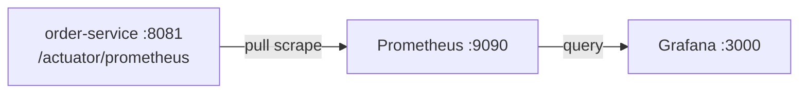

# v1 - Metrics with Prometheus and Grafana

## 1. Goal

Expose Micrometer metrics from `order-service` for Prometheus to scrape, then
explore them in Grafana. Compared with the base app, this version adds direct
Prometheus scraping; it does not include an OpenTelemetry Collector or traces.

## 2. Architecture



## 3. Files in this folder

| File | Purpose |
|---|---|
| `docker-compose.yml` | Starts Prometheus and Grafana with persistent volumes |
| `prometheus.yml` | Scrapes the order service and Prometheus itself |
| `grafana/provisioning/datasources/prometheus.yml` | Provisions Prometheus as Grafana's default data source |

## 4. App state required

This stack's scrape path requires the historical `order-service` state in commit
`eb50be7` of its nested Git repository. That revision has the runtime
`micrometer-registry-prometheus` dependency and exposes `prometheus` in the
Actuator endpoint list on management port `8081`. The current app state instead
pushes OTLP and does not provide `/actuator/prometheus`. The old commit is
available in `order-service` history. In a clean clone of that repository,
check out `eb50be7` before running v1. Do not check it out in a working tree
with local changes. Alternatively, restore the historical runtime dependency
and expose `prometheus` in the Actuator web endpoint list.

⚠️ Not verified: a matching v1 `payment-service` app state is not present in the
available history. This version's Prometheus target is only `order-service`.

## 5. Prerequisites

Use Java 21, Maven Wrapper, Docker Compose, and MySQL 8 for the order service.
Ports `3306`, `8080`, `8081`, `3000`, and `9090` must be available. RAM
requirements are ⚠️ Not verified.

## 6. Start and stop

Start MySQL first; the order-service needs the configured local database:

```powershell
docker run --name observability-mysql -e MYSQL_ROOT_PASSWORD=rootPassword -e MYSQL_DATABASE=orders_db -p 3306:3306 -d mysql:8
```

```bash
docker run --name observability-mysql -e MYSQL_ROOT_PASSWORD=rootPassword -e MYSQL_DATABASE=orders_db -p 3306:3306 -d mysql:8
```

Stop any other stack version first. From this folder, start the stack:

```powershell
docker compose up -d
```

```bash
docker compose up -d
```

In another terminal, start the app from `order-service`:

```powershell
Set-Location ..\order-service
.\mvnw.cmd spring-boot:run
```

```bash
cd ../order-service && ./mvnw spring-boot:run
```

Stop the app with Ctrl+C, then run `docker compose down` from this folder.
`down` keeps named volumes; `down -v` removes the Prometheus and Grafana data.

## 7. Verify it works

1. Check `http://localhost:9090/targets`; the `order-service` target should be
   UP when the historical v1 app state is running.
2. Check `http://localhost:9090/graph` and run `up`.
3. Open `http://localhost:3000` and sign in with `admin` / `admin`.
4. In Grafana, select the provisioned Prometheus data source and run `up`.

## 8. Queries to try

Start with `up{job="order-service"}`. Use the `:8081/actuator/prometheus`
endpoint to discover the exact metric names exposed by the app before building
queries. Dashboard queries from older docs are not carried forward as verified
names.

## 9. Common problems

| Symptom | Check |
|---|---|
| Target is DOWN | Confirm the v1 app exposes `/actuator/prometheus` on `8081`; the current OTLP app does not. |
| Compose reports a port/container conflict | Stop the other version before starting v1. |
| Grafana panels are empty | Confirm Prometheus target health and that the provisioned data source is reachable. |

## 10. Next version

In [v2](../v2-opentelemetry/README.md), replace the app's direct Prometheus
export with OTLP metrics sent through the OpenTelemetry Collector.
