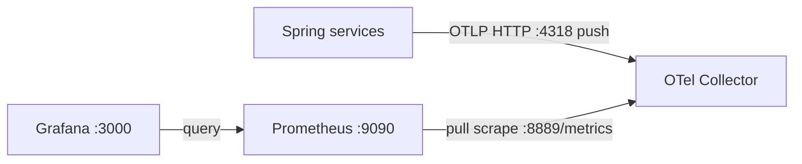

# v2 - OTLP metrics through the OpenTelemetry Collector

## 1. Goal

Send application metrics over OTLP to the Collector, which exposes them for
Prometheus to scrape. Compared with v1, the app no longer exposes a direct
Prometheus endpoint; the Collector is added between the app and Prometheus.

## 2. Architecture



## 3. Files in this folder

| File | Purpose |
|---|---|
| `docker-compose.yml` | Starts the Collector, Prometheus, and Grafana |
| `otel-collector-config.yaml` | Receives OTLP, batches data, exports metrics, and logs traces to Collector output |
| `prometheus.yml` | Scrapes the Collector exporter and Prometheus |
| `grafana/provisioning/datasources/prometheus-datasource.yml` | Provisions Prometheus as Grafana's default data source |

## 4. App state required

The order-service history contains the OTLP transition at commit `e481553`.
Both services need Spring Boot's `spring-boot-starter-opentelemetry` and OTLP
metrics export configured for `http://localhost:4318/v1/metrics`. This
Collector configuration exports metrics only; trace data is sent to its debug
exporter, not a trace backend. The currently checked-out app also exports logs,
but this version has no logs pipeline.

⚠️ Not verified: the exact matching historical `payment-service` app state is
not recorded in the available order-service history.

## 5. Prerequisites

Use Java 21, Maven Wrapper, Docker Compose, and MySQL 8 for order-service. The
stack uses ports `3000`, `4317`, `4318`, `8889`, and `9090`; the services also
use `3306`, `8080`, `8081`, `8082`, and `8083`. RAM requirements are
⚠️ Not verified. Stop any other version first.

## 6. Start and stop

Start MySQL first; order-service uses the configured local database:

```powershell
docker run --name observability-mysql -e MYSQL_ROOT_PASSWORD=rootPassword -e MYSQL_DATABASE=orders_db -p 3306:3306 -d mysql:8
```

```bash
docker run --name observability-mysql -e MYSQL_ROOT_PASSWORD=rootPassword -e MYSQL_DATABASE=orders_db -p 3306:3306 -d mysql:8
```

From this folder, start the stack:

```powershell
docker compose up -d
```

```bash
docker compose up -d
```

Start each Spring service in a separate terminal, from its own folder:

```powershell
.\mvnw.cmd spring-boot:run
```

```bash
./mvnw spring-boot:run
```

Stop both apps with Ctrl+C, then run `docker compose down` here. `down` keeps
named volumes; `down -v` deletes this Compose project's stored Prometheus and
Grafana data. This file does not set a fixed Compose project name.

## 7. Verify it works

1. Check `http://localhost:8889/metrics` for Collector-exported metrics.
2. Check `http://localhost:9090/targets`; the `otel-collector` target should be
   UP.
3. Query `up{job="otel-collector"}` at `http://localhost:9090/graph`.
4. Open `http://localhost:3000` and sign in with `admin` / `admin`; the
   Prometheus data source is provisioned.
5. To see received traces, inspect Collector logs; this version has no trace UI.

## 8. Queries to try

Use `up{job="otel-collector"}` in Prometheus. Inspect
`http://localhost:8889/metrics` before using application metric names: OTLP and
the Collector can affect the final Prometheus names.

## 9. Common problems

| Symptom | Check |
|---|---|
| Collector target is DOWN | Check `docker compose ps` and `docker compose logs otel-collector`. |
| No app metrics | Confirm the app OTLP metrics URL uses port `4318` and inspect the Collector metrics endpoint. |
| Empty Grafana panels | Check target health and the provisioned Prometheus data source; verify query names against `:8889/metrics`. |
| Port or container conflict | Stop the other version before starting v2. |

## 10. Next version

In [v3](../v3-tempo/README.md), add Tempo so you can search and inspect
distributed traces instead of only seeing them in Collector output.
