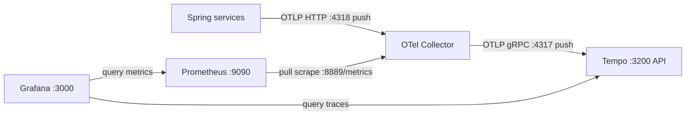

# v3 - Distributed traces with Tempo

## 1. Goal

Add Tempo as a trace backend to v2's OpenTelemetry metrics pipeline. The
Collector now exports traces to Tempo; metrics still flow to Prometheus.

## 2. Architecture



## 3. Files in this folder

| File | Purpose |
|---|---|
| `docker-compose.yml` | Starts the Collector, Tempo, Prometheus, and Grafana |
| `otel-collector-config.yaml` | Routes metrics to its Prometheus exporter and traces to Tempo |
| `prometheus.yml` | Scrapes the Collector metrics exporter |
| `tempo.yaml` | Configures Tempo's OTLP receiver, local storage, and retention |
| `grafana/provisioning/datasources/prometheus-datasource.yml` | Provisions Prometheus |
| `grafana/provisioning/datasources/tempo-datasource.yml` | Provisions Tempo |

## 4. App state required

Both apps need Spring Boot OpenTelemetry and OTLP trace export to
`http://localhost:4318/v1/traces`; metrics use
`http://localhost:4318/v1/metrics`. Order-service history records the OTLP
transition at `e481553`. The current app state has these settings and uses the
injected `RestClient.Builder` so the payment request can join the trace.

⚠️ Not verified: the exact matching historical `payment-service` app state is
not recorded in the available order-service history.

## 5. Prerequisites

Use Java 21, Maven Wrapper, Docker Compose, and MySQL 8 for order-service. This
stack uses host ports `3000`, `3200`, `4317`, `4318`, `8889`, and `9090`; the
services use `3306`, `8080`, `8081`, `8082`, and `8083`. RAM requirements are
⚠️ Not verified. Stop any other version first.

## 6. Start and stop

Start MySQL first; order-service uses the configured local database:

```powershell
docker run --name observability-mysql -e MYSQL_ROOT_PASSWORD=rootPassword -e MYSQL_DATABASE=orders_db -p 3306:3306 -d mysql:8
```

```bash
docker run --name observability-mysql -e MYSQL_ROOT_PASSWORD=rootPassword -e MYSQL_DATABASE=orders_db -p 3306:3306 -d mysql:8
```

Stop v2 from its folder before starting v3:

```powershell
Set-Location ..\v2-opentelemetry
docker compose down
Set-Location ..\v3-tempo
docker compose up -d
```

```bash
cd ../v2-opentelemetry && docker compose down
cd ../v3-tempo && docker compose up -d
```

Run both Spring apps with `.\mvnw.cmd spring-boot:run` (PowerShell) or
`./mvnw spring-boot:run` (bash), from each service folder. Stop apps with
Ctrl+C; stop this stack with `docker compose down` from this folder. That keeps
Prometheus and Grafana volumes. `down -v` deletes those volumes; Tempo trace
data is stored in the container and is lost when it is removed.

## 7. Verify it works

1. Check `http://localhost:3200/ready` for Tempo readiness.
2. Check `http://localhost:8889/metrics` and
   `http://localhost:9090/targets` for Collector-exported metrics and scrape
   health.
3. Open `http://localhost:3000`; sign in with `admin` / `admin` and confirm
   both Prometheus and Tempo data sources are provisioned.
4. Generate a checkout request, then open Grafana Explore, select Tempo, and
   search for the `order-service` trace.

## 8. Queries to try

In Grafana Explore with Tempo selected, try
`{ resource.service.name = "order-service" }` to find order-service traces.
TraceQL field availability depends on the stored resource attributes.

## 9. Common problems

| Symptom | Check |
|---|---|
| Tempo is not ready | Check `docker compose ps` and `docker compose logs tempo`. |
| No trace results | Confirm the app exports to port `4318`, then inspect Collector logs and Tempo readiness. |
| Tempo data disappears after stop | This stack does not mount a Tempo data volume; container removal loses traces. |
| Grafana dashboards are missing | Compose derives volume names from this folder, so v3 has separate Grafana storage; re-import dashboards if needed. |
| Port or container conflict | Stop the other version before starting v3. |

## 10. Next version

In [v4](../v4-loki/README.md), add a log backend and send application logs
through the Collector.
