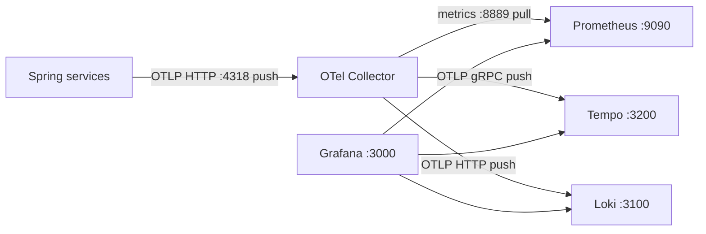

# v4 - Logs with Grafana Loki

## 1. Goal

Add Loki as a logs backend to v3's metrics-and-traces stack. The Collector now
routes OTLP logs to Loki while metrics and traces keep their existing paths.

## 2. Architecture



## 3. Files in this folder

| File | Purpose |
|---|---|
| `docker-compose.yml` | Starts the Collector, Tempo, Loki, Prometheus, and Grafana |
| `otel-collector-config.yaml` | Defines OTLP receivers and metrics, trace, and log pipelines |
| `prometheus.yml` | Scrapes the Collector metrics exporter |
| `tempo.yaml` | Configures Tempo's local trace storage |
| `loki.yaml` | Configures Loki, TSDB schema v13, and structured metadata |
| `grafana/provisioning/datasources/prometheus-datasource.yml` | Provisions Prometheus |
| `grafana/provisioning/datasources/tempo-datasource.yml` | Provisions Tempo and a Loki log link |
| `grafana/provisioning/datasources/loki-datasource.yml` | Provisions Loki and a Tempo trace link |

## 4. App state required

Both apps need the checked-out OpenTelemetry logging setup: the
`opentelemetry-logback-appender-1.0` dependency, `logback-spring.xml`, an
`InstallOpenTelemetryAppender` bean, and
`management.opentelemetry.logging.export.otlp.endpoint` set to
`http://localhost:4318/v1/logs`. The Collector adds a logs pipeline that exports
OTLP HTTP to Loki. No matching historical v4 commit is present in the available
order-service history; the requirements above are read from the current app and
stack configuration.

⚠️ Not verified: Tempo-to-Loki and Loki-to-Tempo links are configured, but the
end-to-end links have not been confirmed.

## 5. Prerequisites

Use Java 21, Maven Wrapper, Docker Compose, and MySQL 8 for order-service. This
stack uses host ports `3000`, `3100`, `3200`, `4317`, `4318`, `8889`, and
`9090`; the services use `3306`, `8080`, `8081`, `8082`, and `8083`. RAM
requirements are ⚠️ Not verified. Stop any other version first.

## 6. Start and stop

Start MySQL first; order-service uses the configured local database:

```powershell
docker run --name observability-mysql -e MYSQL_ROOT_PASSWORD=rootPassword -e MYSQL_DATABASE=orders_db -p 3306:3306 -d mysql:8
```

```bash
docker run --name observability-mysql -e MYSQL_ROOT_PASSWORD=rootPassword -e MYSQL_DATABASE=orders_db -p 3306:3306 -d mysql:8
```

Stop the previous stack before starting v4. From this folder, run:

```powershell
Set-Location ..\v3-tempo
docker compose down
Set-Location ..\v4-loki
docker compose up -d
```

```bash
cd ../v3-tempo && docker compose down
cd ../v4-loki && docker compose up -d
```

Run both Spring apps with `.\mvnw.cmd spring-boot:run` (PowerShell) or
`./mvnw spring-boot:run` (bash), from each service folder. Stop apps with
Ctrl+C; stop the stack with `docker compose down` from this folder. This Compose
file sets `name: v3-tempo`, so it shares the v3 Prometheus and Grafana volumes.
`down -v` removes those shared volumes as well as Loki's data.

## 7. Verify it works

1. Check `http://localhost:3100/ready` and
   `http://localhost:3200/ready` for Loki and Tempo readiness.
2. Check `http://localhost:8889/metrics` and
   `http://localhost:9090/targets` for Collector-exported metrics and scrape
   health.
3. Generate application traffic, then open Grafana at `http://localhost:3000`
   and search Loki Explore for the service logs.
4. Confirm the provisioned Loki and Tempo data sources appear. The configured
   trace/log links are ⚠️ Not verified end to end.

## 8. Queries to try

In Prometheus, use `up{job="otel-collector"}`. In Tempo, try
`{ resource.service.name = "order-service" }`. In Loki, start with
`{service_name="order-service"}`; for a trace-specific search, try
`{service_name="order-service"} | trace_id="<trace-id>"`. The data source
configuration maps the service name and uses `trace_id` as structured metadata.

## 9. Common problems

| Symptom | Check |
|---|---|
| Loki rejects OTLP logs | Confirm `allow_structured_metadata: true`, schema `v13`, and `store: tsdb` in `loki.yaml`. |
| No application logs | Check the appender dependency, Logback config, installer bean, logging OTLP endpoint, and Collector logs pipeline. |
| Loki or Tempo is not ready | Inspect `docker compose ps` and the relevant container logs. |
| v3 dashboards disappear | The fixed Compose name reuses v3 volumes; do not use `down -v` if you want to keep them. |
| Port or container conflict | Stop the other version before starting v4. |

## 10. Next version

In [v5](../v5-opensearch/README.md), compare the Loki log backend with
OpenSearch and Grafana's OpenSearch data source.
