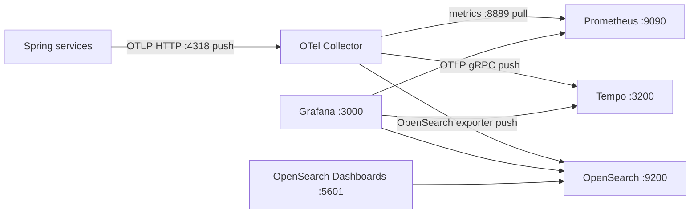

# v5 - Logs with OpenSearch

## 1. Goal

Replace v4's Loki log backend with OpenSearch while keeping Collector-based
metrics and Tempo traces. OpenSearch Dashboards is added alongside Grafana.

## 2. Architecture



## 3. Files in this folder

| File | Purpose |
|---|---|
| `docker-compose.yml` | Starts OpenSearch, OpenSearch Dashboards, the Collector, Tempo, Prometheus, and Grafana |
| `otel-collector-config.yaml` | Routes metrics, traces, and logs to their backends |
| `prometheus.yml` | Scrapes the Collector metrics exporter |
| `tempo.yaml` | Configures Tempo's local trace storage |
| `grafana/provisioning/datasources/opensearch-datasource.yml` | Provisions OpenSearch in Grafana |
| `grafana/provisioning/datasources/prometheus-datasource.yml` | Provisions Prometheus |
| `grafana/provisioning/datasources/tempo-datasource.yml` | Provisions Tempo |
| `loki.yaml` | ⚠️ Legacy Loki config; not mounted by this Compose file |
| `grafana/provisioning/datasources/loki-datasource.yml` | ⚠️ Legacy Loki data source; the provisioning folder is mounted, but v5 has no Loki service |

## 4. App state required

Both apps need the OpenTelemetry logging setup: the
`opentelemetry-logback-appender-1.0` dependency, `logback-spring.xml`,
`InstallOpenTelemetryAppender`, and
`management.opentelemetry.logging.export.otlp.endpoint` set to
`http://localhost:4318/v1/logs`. Metrics and traces also use OTLP at this
Collector. The Collector's logs pipeline exports to OpenSearch index prefix
`otel-logs` using SS4O mapping. The current checked-out app state has these
hooks; no matching historical v5 app commit is present in the available
order-service history.

## 5. Prerequisites

Use Java 21, Maven Wrapper, Docker Compose, and MySQL 8 for order-service. This
stack uses host ports `3000`, `3200`, `4317`, `4318`, `5601`, `8889`, `9090`,
and `9200`; the services use `3306`, `8080`, `8081`, `8082`, and `8083`. The
Compose comments recommend roughly 2 GB of free RAM for OpenSearch and
Dashboards. Stop any other version first.

## 6. Start and stop

Start MySQL first; order-service uses the configured local database:

```powershell
docker run --name observability-mysql -e MYSQL_ROOT_PASSWORD=rootPassword -e MYSQL_DATABASE=orders_db -p 3306:3306 -d mysql:8
```

```bash
docker run --name observability-mysql -e MYSQL_ROOT_PASSWORD=rootPassword -e MYSQL_DATABASE=orders_db -p 3306:3306 -d mysql:8
```

Stop v4 first, then start v5 from this folder:

```powershell
Set-Location ..\v4-loki
docker compose down
Set-Location ..\v5-opensearch
docker compose up -d --remove-orphans
```

```bash
cd ../v4-loki && docker compose down
cd ../v5-opensearch && docker compose up -d --remove-orphans
```

Run both Spring apps with `.\mvnw.cmd spring-boot:run` (PowerShell) or
`./mvnw spring-boot:run` (bash), from each service folder. Stop apps with
Ctrl+C; stop this stack with `docker compose down`. The Compose project name is
`v3-tempo`, so v5 shares the v3/v4 Prometheus and Grafana volumes.
`down -v` deletes those shared volumes and the OpenSearch data volume.

## 7. Verify it works

1. Check OpenSearch at `http://localhost:9200` and its health at
   `http://localhost:9200/_cluster/health`.
2. Check `http://localhost:8889/metrics` and
   `http://localhost:9090/targets` for Collector-exported metrics and scrape
   health.
3. Generate application traffic, then inspect the `otel-logs-*` indices in
   OpenSearch Dashboards at `http://localhost:5601`.
4. Open Grafana at `http://localhost:3000`; use the provisioned OpenSearch data
   source to search logs. The Grafana OpenSearch data source was confirmed by
   the project author; trace/log links are not configured in this version.

## 8. Queries to try

In Prometheus, use `up{job="otel-collector"}`. In Tempo, try
`{ resource.service.name = "order-service" }`. In the Grafana OpenSearch data
source, try the Lucene query `body:*` to find records with a message body.
OpenSearch Dashboards can search the `otel-logs-*` indices.

## 9. Common problems

| Symptom | Check |
|---|---|
| OpenSearch is not ready | Check `docker compose ps`, container logs, and `http://localhost:9200/_cluster/health`. |
| No OpenSearch logs | Confirm the Collector logs pipeline/exporter and inspect `docker compose logs otel-collector`. |
| Grafana shows a Loki data source error | `loki-datasource.yml` is a leftover; v5 has no Loki service. Use the OpenSearch data source. |
| OpenSearch Dashboards cannot connect | Wait for the OpenSearch health check and check the `OPENSEARCH_HOSTS` target. |
| Port or container conflict | Stop the other version before starting v5. |

## 10. Next version

There is no v6 in this repository. Compare the same `otel-logs-*` records in
Grafana and OpenSearch Dashboards, then revisit the v4 Loki setup to compare
their query and storage workflows.
